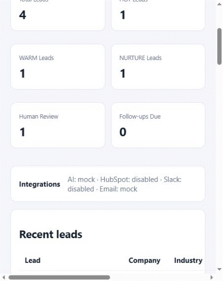
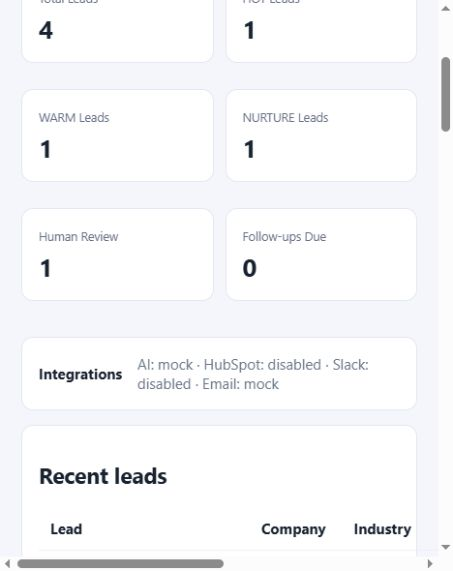
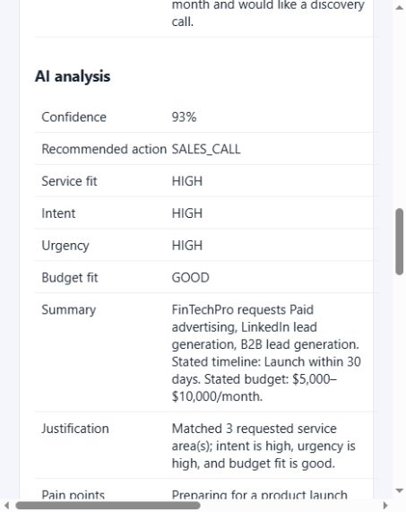
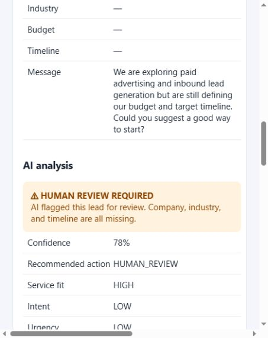
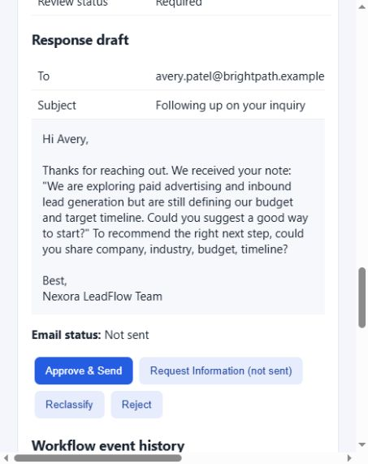

# NEXORA AI — NEXORA LeadFlow

### Human-guided lead qualification and sales operations for B2B marketing agencies

NEXORA LeadFlow turns inbound business inquiries into structured, prioritized sales work. It combines AI-assisted lead understanding with deterministic qualification rules, CRM and Slack adapters, response drafts, and an explicit human approval step before any outbound email.

**Try the live portfolio demo:** [Submit a test inquiry](https://nexora-leadflow.onrender.com/request) · [Explore the read-only demo](https://nexora-leadflow.onrender.com/demo) · [Team sign-in](https://nexora-leadflow.onrender.com/signin)

[Read the product case study](CASE_STUDY.md).



## Architecture and workflow

```text
Inbound Lead → AI Analysis → Deterministic Qualification → CRM Sync → Slack Alert
             → Response Draft → Human Approval → Email → Workflow/Audit Events
```

The workflow is backed by PostgreSQL. Lead intake and analysis are recorded with workflow events. Optional integrations can be disabled or run through local mock providers during development.

## Key Capabilities

- Validated lead intake through the dashboard or API.
- A public, no-account project inquiry form that routes submissions into the private team workspace.
- Structured AI analysis with confidence, service fit, intent, urgency, missing information, and a suggested next action.
- Deterministic qualification rules control final lead classification and review routing.
- Persistent lead, analysis, follow-up, and workflow-event records in PostgreSQL.
- Optional HubSpot CRM synchronization and Slack sales/review notifications.
- Response drafts, human decisions, and an **Approve & Send** email workflow.
- Mock AI, HubSpot, Slack, and email providers for local development without external API calls.
- Per-analysis duplicate-send protection, safe integration status, and event history in the dashboard.

## Tech Stack

- Python, FastAPI, Pydantic, and SQLAlchemy
- PostgreSQL and Alembic migrations
- OpenAI and Gemini structured analysis adapters, deterministic local mock AI provider
- Provider adapters for HubSpot, Slack incoming webhooks, and Resend
- Jinja2 dashboard with browser-side JavaScript
- Docker Compose and pytest

## Project Structure

```text
app/
  main.py                 FastAPI routes and dashboard rendering
  config.py, database.py  Environment settings and SQLAlchemy setup
  models.py, schemas.py   Persistence models and validated API/AI schemas
  services.py             AI providers, qualification, drafts, and workflow
  security.py             Signed private-workspace session cookies
  integrations/           HubSpot, Slack, and email provider adapters
  templates/, static/     Dashboard, sign-in, styles, and browser behavior
migrations/               Alembic migration environment and versions
scripts/                  Optional synthetic demo-data seed
tests/                    API, workflow, provider, and security tests
screenshots/              Synthetic workflow screenshots and walkthrough GIF
```

## Why This Architecture

- **LLM reasoning and structured analysis:** AI interprets an inbound request and returns data validated against the application schema.
- **Deterministic business rules:** Qualification and review routing are controlled by application rules, so the model’s suggested classification does not control final routing by itself.
- **PostgreSQL persistence:** Leads, analyses, follow-ups, and workflow events survive application restarts and can be migrated through Alembic.
- **External integrations and adapters:** HubSpot, Slack, and email are isolated behind provider interfaces. Mock providers support development and tests; integration failures are recorded without silently discarding an accepted lead.
- **Human approval and control:** The response draft remains unsent until a reviewer explicitly approves it. Approval and send results are recorded in workflow history.

## Security & Human Control

- Keep API keys, tokens, webhook URLs, and sender configuration in environment variables or a deployment secret manager.
- Do not commit `.env`; it is excluded by `.gitignore` and `.dockerignore`. `.env.example` contains placeholders only.
- Production workspace access requires environment-provisioned owner credentials, a session signing secret, and secure session cookies. The public demo uses synthetic records and cannot access or mutate workspace data.
- AI analysis, CRM synchronization, and Slack notification do not send external email. A human must use **Approve & Send** before the email provider is called.
- Reject and Request Information do not send email. Duplicate approvals for an already-sent analysis draft do not send a second email.
- Workflow/audit events record key processing, reviewer, and integration outcomes without storing provider credentials or the full email body.
- Integration failures are logged with safe categories and recorded as events. Lead intake remains available when optional CRM or Slack integrations fail; an email send failure is returned safely and can be retried.
- The health endpoint reports provider mode/configuration only. It does not perform external connectivity checks or claim that configured credentials are reachable.

## Screenshots

The screenshots use synthetic demo leads and `.example` email addresses. They were captured locally with mock AI and external integrations disabled; no live CRM, notification, or email requests were made.

### Dashboard and lead queue



### AI qualification and confidence



### Human review and missing information



### Response draft and approval gate



### Workflow in motion


## Public demo and private workspace

The live portfolio deployment is available at [nexora-leadflow.onrender.com](https://nexora-leadflow.onrender.com). Share the [public inquiry form](https://nexora-leadflow.onrender.com/request) with visitors who want to try lead intake. They can also explore the [read-only synthetic demo](https://nexora-leadflow.onrender.com/demo). The private team workspace is at [sign-in](https://nexora-leadflow.onrender.com/signin); use the owner credentials configured in Render. Public form submissions are validated, require contact consent, and enter the private lead workflow; real workspace records are never shown in the synthetic demo. There is no public account registration or per-customer portal. For local development, authentication is off by default; set `AUTH_ENABLED=true` and the session/owner credentials to exercise sign-in.

## Quick Start

### Local development

Use `MOCK_AI=true` for no-credit AI development. It selects local deterministic analysis and makes no OpenAI or Gemini API calls. With `MOCK_AI=false`, `AI_PROVIDER=gemini` selects Gemini, and `AI_PROVIDER=openai` selects the existing OpenAI adapter. Integration modes are configured independently: enabled HubSpot or Slack with credentials can make live requests, and configured production Resend can send email after human approval, even while `MOCK_AI=true`. To prevent all external integration requests, leave `HUBSPOT_ENABLED`, `SLACK_ENABLED`, and `RESEND_ENABLED` set to `false` as in `.env.example`.

1. Copy `.env.example` to `.env` if `.env` does not already exist. Preserve your existing `.env` if you already have one.
2. Install Python 3.11 or newer and the project dependencies.
3. Start PostgreSQL, apply migrations, and run the API:

```powershell
docker compose up -d db
python -m pip install -r requirements.txt
alembic upgrade head
uvicorn app.main:app --reload
```

The dashboard is at `http://localhost:8000`, the generated API documentation is at `/docs`, and health/status is at `/api/health`.

### Docker Compose

The app container waits for PostgreSQL’s health check, applies `alembic upgrade head`, and then starts Uvicorn. Compose reads the app environment from `.env` and configures the container’s database URL to use the `db` service.

```powershell
docker compose up --build
docker compose ps
docker compose down
```

`docker compose down` stops and removes the Compose containers and network. The named PostgreSQL data volume is retained unless explicitly removed.

### Windows PowerShell setup

From the project folder, after installing Python 3.11 or newer:

```powershell
py -3.11 -m venv .venv
.\.venv\Scripts\Activate.ps1
python -m pip install --upgrade pip
pip install -r requirements.txt
if (-not (Test-Path .env)) { Copy-Item .env.example .env }
# Keep MOCK_AI=true for local development; no OpenAI key is needed.
# Keep DATABASE_URL pointed at localhost when using the local Compose database.
docker compose up -d db
alembic upgrade head
uvicorn app.main:app --reload
```

To run the whole stack in containers instead, use `docker compose up --build` from the project folder.

## Configuration

Set configuration in `.env` for local development or through deployment secrets in hosted environments. Never paste credentials into source files or commit them.

| Variable | Purpose |
| --- | --- |
| `DATABASE_URL` | SQLAlchemy database connection. Local Compose development uses PostgreSQL on `localhost`; the app container receives a URL pointing to `db`. |
| `OPENAI_API_KEY` | Credential for live AI analysis when `MOCK_AI=false`. Leave blank in mock mode. |
| `OPENAI_MODEL` | OpenAI model used by the live provider; the example is `gpt-4o-mini`. |
| `AI_PROVIDER` | Live AI adapter to use when mock mode is off: `openai` or `gemini`. |
| `GEMINI_API_KEY` | Google AI Studio API key used only when `MOCK_AI=false` and `AI_PROVIDER=gemini`. |
| `GEMINI_MODEL` | Gemini model identifier; the example is `gemini-3.8-flash`. |
| `MOCK_AI` | Selects deterministic local AI analysis when `true`; `.env.example` sets `true`. |
| `HUBSPOT_ENABLED` | Enables the HubSpot adapter. Defaults to `false`. |
| `HUBSPOT_ACCESS_TOKEN` | HubSpot credential required by the enabled live adapter. |
| `SLACK_ENABLED` | Enables Slack notifications. Defaults to `false`. |
| `SLACK_WEBHOOK_URL` | Webhook URL required by the enabled live Slack adapter. |
| `RESEND_ENABLED` | Enables live email configuration. Defaults to `false`. |
| `RESEND_API_KEY` | Resend credential used only by the configured production adapter. |
| `RESEND_FROM_EMAIL` | Verified sender address/name used for Resend email. |
| `INTEGRATION_TIMEOUT_SECONDS` | Timeout for external integration requests; example value is `5`. |
| `AI_CONFIDENCE_THRESHOLD` | Confidence threshold used by deterministic review routing; example value is `0.65`. |
| `HIGH_VALUE_BUDGET_MONTHLY` | Monthly budget threshold used by qualification/review rules; example value is `25000`. |
| `CORS_ORIGINS` | Comma-separated allowed browser origins; example value is `http://localhost:8000`. |
| `APP_ENV` | Application environment. Live Resend requires `production` (or `prod`). |
| `AUTH_ENABLED` | Enables private workspace sign-in outside production; production always requires sign-in. |
| `SESSION_SECRET_KEY` | Secret used to sign the private workspace session cookie; required in production. |
| `ADMIN_EMAIL` | Owner email allowed to sign in; required when authentication is enabled. |
| `ADMIN_PASSWORD` | Owner password allowed to sign in; required when authentication is enabled. |

`MOCK_AI` selects only the AI provider. When disabled, `AI_PROVIDER` selects Gemini or OpenAI. When HubSpot or Slack is enabled and its credential is present, the corresponding live adapter is selected regardless of `MOCK_AI`; when enabled credentials are absent, mock mode uses the mock adapter and live mode reports the integration as unconfigured. Resend is selected only when `APP_ENV=production`, `RESEND_ENABLED=true`, and both Resend settings are present, regardless of `MOCK_AI`. Otherwise, mock AI mode uses Mock Email; live AI mode retains the disabled/unconfigured fallback. A missing key for the selected live AI provider causes the lead to be saved without a classification and records an error/review event.

## Integrations and email approval

HubSpot upserts qualified leads and records CRM outcomes. Slack can notify the sales team about qualified leads, required human review, or integration errors. Both integrations are disabled by default. With `MOCK_AI=true`, enable either integration without its live credential to use its mock adapter without HTTP requests. If the relevant credential is present, the enabled integration uses its live adapter even when AI remains mocked.

The email body uses the existing response draft; the application does not generate a second AI response for sending. A reviewer explicitly approves the draft through `POST /api/leads/{id}/approve` or the dashboard’s **Approve & Send** action. A successful send is recorded for that analysis; a repeated request returns an already-sent status. Failed sends record a safe failure event and may be retried. For live Resend, set `APP_ENV=production`, `RESEND_ENABLED=true`, `RESEND_API_KEY`, and `RESEND_FROM_EMAIL` through deployment secrets. The configured sender must be accepted by the Resend account before live delivery; AI mock mode does not change email provider selection.

## Example lead

The project’s synthetic walkthrough includes Sarah Chen at Northstar Analytics (`sarah.chen@northstar.example`), a B2B SaaS lead asking for paid advertising and LinkedIn lead generation with a stated $8,000 monthly budget and a 30-day timeline. The records in the public demo and screenshots are examples only; they are not customer data or business results.

## Future integrations

The existing adapter boundaries are intended to support future website-form/webhook and n8n intake, additional CRMs, Teams notifications, calendar scheduling, and approved email providers. Those are extension points, not claims that these connectors are currently implemented.

## API Endpoints

- `POST /api/leads` — validate and submit a lead.
- `GET /signin` and `POST /signin` — public entry/login page and owner sign-in form.
- `POST /logout` — end the private workspace session.
- `GET /demo` — public, read-only sample dashboard using synthetic records.
- `GET /request` and `POST /request` — public project inquiry form; requires contact consent and records the inquiry in the private lead workflow.
- `GET /api/leads` — list recent leads (private workspace session required).
- `GET /api/leads/{id}` — retrieve lead detail and workflow events (private session required).
- `POST /api/leads/{id}/reanalyze` — run and persist a new analysis (private session required).
- `POST /api/leads/{id}/review` — approve, reject, request information, or reclassify without sending email (private session required).
- `POST /api/leads/{id}/approve` — record explicit approval and attempt to send the existing draft (private session required).
- `GET /api/dashboard/summary` — retrieve dashboard metrics (private session required).
- `GET /api/health` — check database availability and safe provider modes/configuration.
- `/docs` — FastAPI-generated OpenAPI documentation.

## Testing

Run the suite from the project folder:

```powershell
pytest
```

Tests use an in-memory SQLite database and mock or stub all external providers. They do not call Gemini, OpenAI, HubSpot, Slack, or Resend. The suite covers lead validation and qualification, public request submission and consent, private workspace authentication, workflow persistence, provider selection, reanalysis and dashboard APIs, integration failure handling, reviewer decisions, duplicate-send protection, and email retry behavior.

## Migrations

Apply the current migration:

```powershell
alembic upgrade head
```

After changing SQLAlchemy models, generate a candidate migration, review it, and then apply it:

```powershell
alembic revision --autogenerate -m "describe change"
alembic upgrade head
```

The Docker app startup also runs `alembic upgrade head` before starting the web server. Do not use destructive migration commands against a database containing data you need to keep.

The optional demo seed can be run after migrations with `python -m scripts.seed_demo`. It is idempotent by its demo email address. Keep `MOCK_AI=true` for a no-credit analysis.

## Render Portfolio Deployment

The repository includes a Render Blueprint in `render.yaml` for a free Docker web service and free managed PostgreSQL demo database. The live portfolio instance is running with `MOCK_AI=true`, so lead analysis makes no OpenAI or Gemini API calls. The signing key is generated by the Blueprint, and the private workspace uses owner credentials configured in Render. HubSpot, Slack, and Resend can use live adapters when credentials are configured in Render; otherwise the existing mock/unconfigured provider behavior applies. Resend sends only after a signed-in reviewer approves a draft. Never put credentials in GitHub.

Render’s free web service can spin down while idle. Its free PostgreSQL database expires after 30 days, has no backups, and can be restarted or taken offline for maintenance. Use this deployment for portfolio demonstrations and test leads only, not as a store for real customer inquiries. The health endpoint reports configuration state, not external service reachability. Review the hosting plan limits and costs before provisioning. For durable production lead intake, use a persistent managed database and configure the required live AI/integration credentials in the deployment environment.

The Compose database credentials are local-development values only; do not reuse them in a hosted production environment. Never commit `.env` or real integration secrets.
